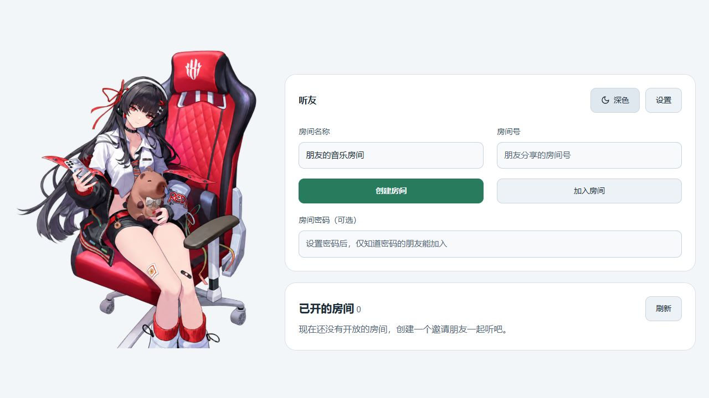
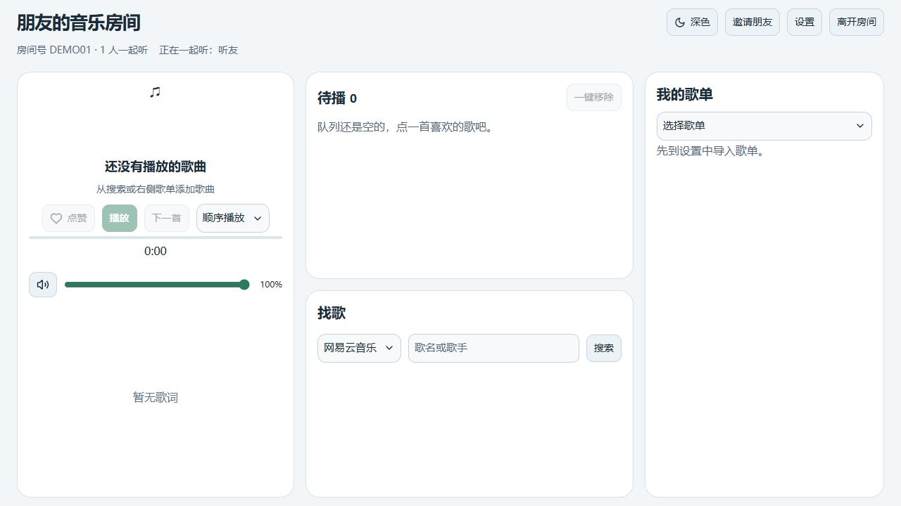
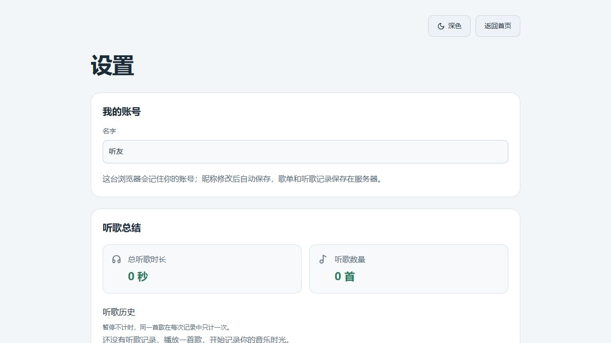
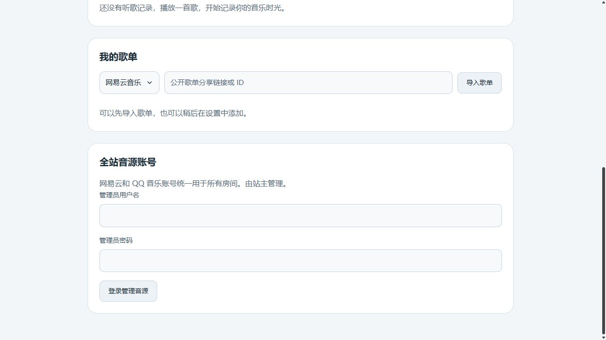

<h1 align="center">🎵 𝑻𝒖𝒏𝒆 𝑰𝒏 𝑻𝒐𝒈𝒆𝒕𝒉𝒆𝒓</h1>

<p align="center">和朋友一起点歌、同步听歌、看歌词。</p>

本项目是基于 [OpenMusic](https://github.com/qq01-hub/openmusic) 修改的朋友一起听网页，当前页面由 `FriendsHome`、`FriendsRoom` 和 `FriendsSettings` 实现。

## 当前界面

以下截图来自本项目实际前端，在隔离的空数据演示服务中重新拍摄。昵称“听友”、房间号 `DEMO01` 为演示值；截图不包含真实音乐账号、导入的歌单或听歌历史。

### 首页

左侧角色插画，右侧创建／加入房间及已开房间列表；支持可选房间密码和浅色／深色主题。



### 房间

三栏布局：左侧播放器与同步歌词，中间待播队列与找歌，右侧个人歌单。成员和播放状态随房间同步，可复制链接邀请朋友。



### 设置

昵称、听歌总结、个人歌单以及全站音源账号管理集中在设置页。音乐平台扫码登录需要站点管理员身份。





## 功能

- 创建、加入及邀请朋友进入房间，显示在线听友。
- 网易云与 QQ 音乐搜索，导入公开歌单链接或 ID。
- 同步播放、暂停、进度、下一首和播放模式；队列上移／下移及清空确认。
- 同步歌词及已有中文译文匹配；实际可播放范围取决于音源接口、地区和账号权益。
- 保存个人歌单、累计听歌时长、听歌历史和歌曲点赞。
- 浅色／深色主题及手机布局。
- 可选微信 AI 陪听，需要另外部署兼容的 AiChat 服务，见[陪听说明](docs/WECHAT-COMPANION.md)。

## 运行

准备 Node.js 22、Redis 及 [Meting-API](https://github.com/qq01-hub/Meting-API)。在自己的环境创建独立数据目录与 Redis 存储，不要复用他人的运行配置或音乐账号数据。

```sh
git clone https://github.com/irrelevant0721/tune-in-together.git
cd tune-in-together
npm ci --prefix client
npm ci --prefix server
npm run build:check
npm start
```

访问 `http://localhost:4000`，按首次部署向导配置域名、Redis 与音源；业务配置优先在管理后台维护。全站网易云／QQ 音乐账号由部署者自己扫码登录，个人歌单由使用者自己导入。

源代码部署细节见 [部署指南](docs/DEPLOY.md)；Friends 容器配置见 [Friends 部署说明](FRIENDS-DEPLOYMENT.md)。文档与导出配置中的示例域名需要替换为自己的地址。

## 源码和个人数据

本仓库包含当前修改版本的完整源码及保留的上游基础模块，不是单独抽出的修改补丁。当前主站路由见 [App.tsx](client/src/App.tsx)。

| 内容 | 存储位置 | 是否包含在发布源码中 |
| --- | --- | --- |
| 网易云／QQ 登录凭据、Meting 账号数据 | 部署者自己的 `data/meting/` | 不包含 |
| 管理员凭据、运行配置和密钥 | Redis、运行时配置和真实环境配置文件 | 不包含 |
| 导入歌单和昵称 | Redis 的 `openmusic:friends-library:v1:*` | 不包含 |
| 听歌历史、统计和点赞 | Redis 的 `openmusic:friends-listening:v1:*` | 不包含 |
| 浏览器身份、主题和本机偏好 | 浏览器 Cookie／localStorage | 不包含 |

仓库保留这些功能的实现代码和配置示例。使用全新的数据目录、Redis 与浏览器身份部署时，需要自行建立账号和歌单；连接原有数据存储则会继续读取原有记录。源码发布不会退出或清空本机正在使用的账号与数据。

## 来源与许可

基于 OpenMusic，本地开发基线为 `6c98d0a`。保留原项目名称、仓库链接及 [LICENSE](LICENSE) 中的版权声明。Mineradio、sonic-topography、React Bits 等第三方代码来源和待核对事项见 [THIRD_PARTY_NOTICES.md](THIRD_PARTY_NOTICES.md)。根许可证不替代各第三方代码的许可。

本仓库当前公开不表示第三方实际引用版本、额外授权及图片资源权利已全部核实。发布与验证记录见 [发布准备](docs/GITHUB-RELEASE.md)、[源码与个人数据核对](docs/PUBLIC-DATA-AUDIT.md)。
